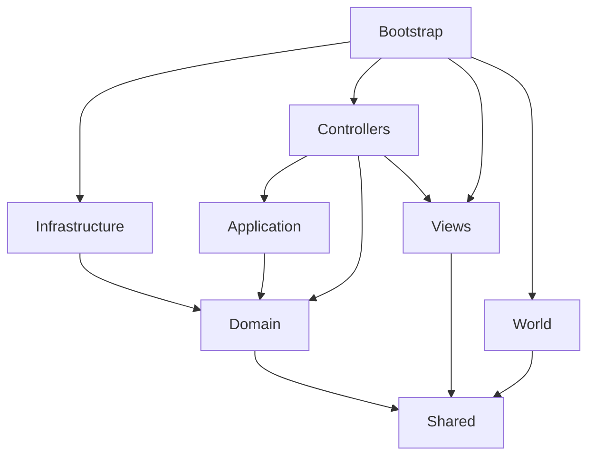

# Kiến trúc Hồi Âm — Godot

Ngày: 2026-10-10. Trạng thái: Chapters 00–12 có implementation kỹ thuật; full
gameplay/formula parity, native save/export và extension workflow đã kiểm chứng.
Production visual/pixel parity vẫn có gate riêng ở review cuối.
Định hướng Godot 4.7.2, GDScript, PC Forward+, world 3D + sprite + UI 2D.

## Mục tiêu

Thay renderer/runtime và cách authoring, giữ hành vi gameplay có đối chứng.
Clean Architecture được áp dụng ở hướng phụ thuộc và ownership. Scene/node là
công cụ presentation/spatial; không ép domain thành node, cũng không bọc mọi
Godot API trong một framework. Một file làm một vai trò cụ thể.

## Cấu trúc

```text
content/                         JSON authored: text, definitions, balance, layouts
  locales/vi.json                nguồn chữ duy nhất của runtime
  ui/bootstrap.json              text-key mapping của màn boot
  manifest.json                  version và đường dẫn pack đang dùng
src/
  domain/                       rules/validators thuần, hai ruleset riêng
  application/game_session.gd    ownership và command boundary
  shared/text_catalog.gd         lookup/interpolation trên catalog được inject
  infrastructure/content/        đọc JSON qua FileAccess
  presentation/bootstrap/        view scene/script nhận view model
  presentation/theme/            Theme resources và typography
  presentation/controllers/     gameplay/formula/text/dialogue/management models
  world/                        room/actor/camera/atmosphere scene-script pairs
  bootstrap/main.*               composition root, startup và lifecycle
assets/                         art/fonts/audio runtime và nguồn được chọn
tests/                          headless contracts, sau đó parity/integration
tools/                          Python checks và migration authoring
docs/                           kiến trúc, chapter, reference và review
```

Gameplay, formula_sandbox, native save adapters, management controllers/views và
playable composition đã có implementation cụ thể. Không tạo implementation rỗng.
Đặt scene cùng script của nó. Art dùng chung ở assets; material/scene riêng của
một room đặt cạnh room đó. Không có thư mục scripts/scenes khổng lồ tách đôi.

## Hướng phụ thuộc



| Lớp | Được tham chiếu trực tiếp | Không sở hữu |
| --- | --- | --- |
| shared | shared | I/O, scene, session |
| domain | domain, shared | Node, file, network, input, clock, random toàn cục |
| application | application, domain, shared | SceneTree, storage implementation |
| infrastructure | infrastructure, domain, shared | UI hoặc command orchestration |
| presentation views | presentation, shared | domain outcome, session, persistence |
| presentation/controllers | presentation, application, domain, shared | storage cụ thể, world implementation |
| world | world, shared | lịch, energy, tiền, nghiệp vụ, save service |
| bootstrap | tất cả các lớp | công thức và chi tiết nội bộ view/room |

`RefCounted`, Dictionary, Array, scalar là công cụ thực thi bên trong Godot.
“Thuần” ở đây nghĩa là deterministic, không phụ thuộc scene hay side effect;
không tuyên bố GDScript có thể chạy bên ngoài Godot.

## Composition và scene ownership

`project_startup.gd` đọc manifest, validate pack, tạo catalog/rules/validator và
GameSession thật. Main giữ dependencies để callback owners sống cùng session.
Callable của RefCounted không được xem là thay thế cho việc giữ owner trong
composition. Preview calendar giữ dependencies riêng và inject session/text
vào controller; room/UI preview dùng fixture có nhãn rõ và chạy độc lập.

Ba scene preview cùng playable/sandbox là entry cụ thể. Main
mount/unmount một entry; scene local signals yêu cầu quay lại. Session preview
khởi tạo lại mỗi lần vào. Playable root giữ controller/room/UI/save dependencies;
local modal priority khoá world input. Session chỉ thay khi command/load đã validate.

View nhận model chỉ gồm dữ liệu hiển thị và emit intent bằng local signal.
Controller chuyển intent thành command, nhận snapshot rồi dựng model mới.
World emit target/location IDs qua signal; Main nối world với controller, không
để controller import room hoặc room truy cập session. Nút/hitbox độc lập art.

Không có autoload ở foundation. Chỉ thêm autoload khi có yêu cầu lifecycle cụ thể
và ADR. Không global event bus, service locator, generic ECS hay plugin framework.

## Contract session và transition

`GameSession.new(transition, validator)` nhận hai Callable. `replace(candidate)`
validate bản sao trước khi sở hữu; `execute(command)` chỉ commit nếu transition
thành công và state mới hợp lệ. `snapshot()` và result là deep copy.

- Validator: `(state: Dictionary) -> {ok, error?}`; không chỉnh candidate.
- Transition: `(state, command) -> {ok, state, events}` hoặc `{ok: false, error}`.
- Error: `{code, text_key?, parameters?}`; không có đoạn văn đã dịch.
- Event: ID và text key/parameters nếu cần hiển thị; schema sẽ khóa ở Chapter 2.
- State: dữ liệu JSON-compatible, stable IDs, không chứa Node, Resource hoặc Callable.

Callable là điểm nối nhỏ tương ứng hai hàm domain của project cũ; không mở hệ
thống registry command tổng quát. Một session ứng với một ruleset. Gameplay và
formula_sandbox có validator, lịch, content, baseline và save riêng.

## Content và text

JSON là source of truth mới; vi.json giữ các key cũ để port log/save không mất
tham chiếu. Catalog hiện nhập từ source, bổ sung `ui.common.quit`. Khi sửa text,
sửa JSON của project này; không đồng bộ hai chiều về JavaScript.

JsonContentLoader đọc file ở infrastructure. Domain nhận definitions đã validate
qua constructor/hàm, không tự đọc res://. TextCatalog nhận Dictionary, trả lỗi
cấu trúc nếu thiếu key/parameter. Không fallback thành key hoặc đoạn tiếng Anh.
View nhận text đã resolve; không bake chữ trong scene/image. Live language
switching, fallback locale và pluralization chỉ thêm khi có yêu cầu thực tế.

## World 2.5D

Camera, navigation, collider và ánh sáng ở world. Spatial position không phải
gameplay progression. Walking/animation không đổi ngày/energy. Gameplay lưu
location ID nằm trong world envelope riêng; composition restore sau physics frame
và safe-spawn query, không nhét coordinates vào domain gameplay.
Sprite nhận/đổ bóng cần review riêng; có thể dùng shadow proxy để giữ silhouette.

Newsroom nhận room/actor definitions và Texture2D được inject. Geometry boxes,
camera presets, ánh sáng, tốc độ, collider, target/spawn/portal metadata ở content.
CharacterBody3D đi trên XZ; rig giữ foot pivot, distance-based walk, idle/talk timing.
Room nhận NPC presentation model mà không tính lịch hoặc availability gameplay.

UI giữ plane 1672×941, uniform fit/letterbox. DOF, fog và world exposure không
được làm mờ chữ UI. View/room có preview fixture riêng; fixture không thay save thật.

## Verification và mở rộng

Architecture checker kiểm tra imports/path/global class, inner-layer APIs, text
assignments, catalog, tài liệu và giới hạn file. Đây là lexical guard, chưa phải
proof mọi dataflow đều đúng. Headless tests kiểm tra ownership/text/boot thực thi.
Visual review và Forward+ device performance có evidence riêng.

Khi có feature mới: content/schema → pure domain → session/use case → controller
→ scene/view → parity và UI/world review. File runtime tối đa 200 dòng không rỗng;
chia theo trách nhiệm, không chia cơ học thành base classes.

Hiện có [source mapping](migration/source-mapping.md),
[behavior ledger](migration/behavior-ledger.md) và
[state schema v3](decisions/002-gameplay-state-v3.md). `content_validation.gd`
validate pack trước tạo rules; `state_migration.gd` thuần chuyển legacy fields,
rồi state validator kiểm tra trước replacement. Text refs/number descriptors
được resolve trong `presentation/controllers/gameplay_text.gd`.

Tham khảo Godot chính thức:
[scene organization](https://docs.godotengine.org/en/stable/tutorials/best_practices/scene_organization.html),
[project organization](https://docs.godotengine.org/en/stable/tutorials/best_practices/project_organization.html).
