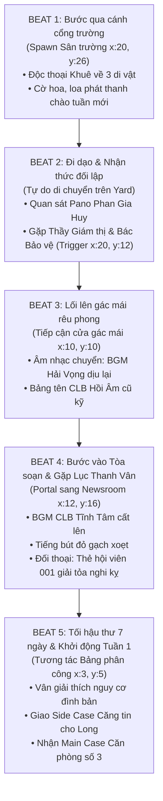

# THIẾT KẾ KỂ CHUYỆN MÔI TRƯỜNG & NHỊP ĐIỆU MÀN MỞ ĐẦU (PROLOGUE)
## DỰ ÁN: HỒI ÂM (CLB BÁO CHÍ THPT TĨNH TÂM)

**Tác giả:** Game Designer / Level Designer (Environmental Narrative Lead)  
**Phiên bản:** 1.0 — Thiết kế sản xuất chi tiết  
**Tài liệu tham chiếu:** `docs/history/narrative/game_story_bible.md`, `content/maps/definitions.js`, `src/pixel/maps.js`, `docs/design/art/AUDIO-BGM-SPEC.md`, `docs/engineering/ARCHITECTURE.md`

---

## 1. TỔNG QUAN TRIẾT LÝ & Ý ĐỒ KỂ CHUYỆN MÔI TRƯỜNG (ENVIRONMENTAL STORYTELLING)

Trong *Hồi Âm*, môi trường không chỉ là sân khấu cho các nhân vật di chuyển mà chính là **một nhân chứng câm lặng** ghi lại lịch sử 15 năm thăng trầm của ngôi trường THPT Tĩnh Tâm.

Màn mở đầu (Prologue) gánh vác 3 trọng trách tự sự và cảm xúc:
1. **Khắc họa sự tương phản gay gắt (Visual & Thematic Duality):** Đặt bề mặt hào nhoáng, giả tạo của một "ngôi trường điểm chuẩn bị đón thẩm định 5 năm" đối lập với những góc khuất bị ruồng bỏ, rêu phong — nơi sự thật và lý tưởng cũ bị chôn vùi.
2. **Kể chuyện không lời qua từng vết tích vật lý (Micro-narratives through Props):** Người chơi cảm nhận được nỗi cô độc, sự kiệt quệ nhưng kiên cường của Lục Thanh Vân trước cả khi nghe cô cất lời chào, thông qua chiếc tách trà nguội ngắt, xấp bản thảo gạch đỏ và chiếc máy in kim kẹt giấy.
3. **Chuyển giao di nguyện và động lực hành động:** Biến chiếc ba lô nặng trĩu của Diệp Khuê (chứa di vật của Thầy Diệp Văn Trí) thành cầu nối mở ra cánh cửa căn phòng số 3, biến cuộc giải cứu CLB khỏi tối hậu thư 7 ngày thành mục tiêu tự nhiên, cấp bách của người chơi.

---

## 2. THIẾT KẾ MAP YARD (SÂN TRƯỜNG TĨNH TÂM) — SỰ ĐỐI LẬP KHÔNG GIAN

### 2.1. Ý đồ cấu trúc không gian (Spatial Layout & Contrast)
Map `yard` (kích thước $40 \times 28$ tiles) được tổ chức theo trục Bắc – Nam và Đông – Tây tạo ra hai thế giới đối lập:

```text
       [BẮC: KHU NHÀ HIỆU BỘ & LỚP HỌC MỚI (Trang nghiêm, Cờ hoa, Camera)]
                             │
 [TÂY BẮC: DÃY NHÀ C CŨ]     │     [ĐÔNG BẮC: KHU THỂ CHẤT ĐANG SƠN SỬA]
 (Rêu phong, Tường tróc vữa,  │     (Khung thép mới, Băng rôn Hải Vọng Corp)
  Cầu thang gỗ lên Gác mái)  │
             ▲               │
             │ Lối rẽ gạch vỡ│
                             ▼
              [TRỤC TRUNG TÂM: ĐƯỜNG GẠCH MEN TRẮNG]
                    (Loa phóng thanh, Pano 5 năm)
                             │
                             ▼
              [NAM: CỔNG TRƯỜNG NHÌN RA BIỂN HẢI VỌNG]
```

#### Phân vùng A: Khu Đông & Nhà Mới (Biểu tượng của trật tự và bệnh thành tích)
* **Thị giác chủ đạo:** Tường sơn vàng kem mới tinh, gạch lát sáng bóng (Tile 2, 6, 7). 
* **Chi tiết môi trường:**
  * Băng rôn đỏ thắm giăng ngang hàng cột: *"Chào mừng Đoàn Thẩm định Chất lượng Giáo dục Toàn diện 2026"*.
  * Pano tuyên truyền lớn của Hội Học Sinh: In hình Chủ tịch Hội học sinh Phan Gia Huy tươi cười bên cạnh khẩu hiệu *"Kỷ cương — Chuẩn mực — Khát vọng Quốc tế"*.
  * Logo nhà tài trợ kim cương: Biểu trưng sóng biển cách điệu của **Hải Vọng Corp** dán ngay lối vào nhà thể chất đang gấp rút quét vôi mới để che đi vết lún chân tường.
  * Camera an ninh giám sát gắn ở các góc mái hiên, bảng nội quy cấm tụ tập học sinh ngoài giờ.
  * Âm thanh ngầm định: Tiếng loa phát thanh trường phát bản tin chào tuần mới bằng giọng đọc khuôn mẫu, tiếng chổi quét sân lia lịa của đội trực nhật.

#### Phân vùng B: Góc Tây Bắc & Dãy nhà C cũ (Biểu tượng của ký ức bị lãng quên)
* **Thị giác chủ đạo:** Mái ngói rêu phong, tường vôi vàng truyền thống đã nứt nẻ và loang lổ vết ẩm ướt của gió biển miền Trung, bậc thềm đá mòn gót (Tile 1, 13).
* **Chi tiết môi trường:**
  * Giàn hoa giấy dại đỏ tía mọc leo bám lấy ban công mục rỉ, cánh hoa rơi rụng phủ mờ lối đi dẫn lên gác mái tầng 3.
  * Cầu thang bộ bằng xi măng cũ kỹ với tay vịn gỗ bong tróc, nằm lùi sâu sau bóng mát của hai cây phượng vĩ cổ thụ (`tree-3-4`, `tree-3-11`).
  * Góc bảng thông báo gỗ có mái che cổ kính nhưng kính đã mờ bụi, bên trong ghim một góc tập san *Hồi Âm* từ năm 2010 đã ố vàng, mép giấy quăn queo.
  * Biển chỉ dẫn kim loại gỉ sét: Chữ *"Căn phòng số 3 — CLB Báo chí"* bị một tấm biển nhựa ghi *"Kho chứa thiết bị cũ — Không phận sự miễn vào"* đóng đè lên một góc.

---

## 3. THIẾT KẾ MAP NEWSROOM (PHÒNG CLB HỒI ÂM) — TỪNG GÓC PHÒNG KỂ CHUYỆN

Map `newsroom` (kích thước $26 \times 20$ tiles, sàn gỗ ván hẹp Tile 3, thảm cũ Tile 14) nằm trên tầng gác mái dãy nhà C. Căn phòng ngập tràn chất điện ảnh hoài niệm và mùi hương đặc trưng: mùi giấy báo cũ, mùi mực in khô, mùi gỗ ẩm và hương gió biển thốc qua khe cửa sổ.

```text
 ┌────────────────────────────────────────────────────────────────────────┐
 │ [GÓC TÂY BẮC]               [GÓC BẮC: CỬA SỔ VÒM]        [GÓC ĐÔNG BẮC]│
 │ Tủ hồ sơ lưu trữ 2008-2010  Cửa sổ vòm nhìn ra vịnh biển Máy in kim    │
 │ (Có ngăn 2011 niêm phong)   (Gió biển, vệt nắng chiều)   cổ & Bàn in   │
 │                                                                        │
 │ [CẠNH TÂY]                                               [CẠNH ĐÔNG]   │
 │ Bảng phân công 7 ngày       [BÀN KHUÊ - GIỮA PHÒNG]      Bàn làm việc  │
 │ (Dán tối hậu thư thu hồi)   Bàn gỗ cũ, máy cassette của ông của Vân (gạch đỏ)
 │                                                                        │
 │                                                          [ĐÔNG NAM]    │
 │ [TÂY NAM]                   [CỬA CHÍNH TẦNG GÁC MÁI]     Chậu hoa nhài │
 │ Đồng hồ quả lắc dừng giờ    (Thảm lau chân sờn gót)      của cô giáo cũ│
 └────────────────────────────────────────────────────────────────────────┘
```

### 3.1. Góc làm việc của Lục Thanh Vân (Tọa độ $x: 18, y: 7 - 9$)
* **Hiện trạng thị giác:** Bàn gỗ ép sờn cạnh, bề mặt ngập tràn giấy tờ và bản thảo bản in thử A4.
* **Những chi tiết kể chuyện:**
  * **Những nét gạch đỏ gay gắt:** Hàng chục trang bài viết bị gạch chéo bằng bút dạ đỏ với những dòng ghi chú nắn nót nhưng quyết liệt: *"Thiếu nguồn kiểm chứng"*, *"Chưa phỏng vấn người bị hại"*, *"Đây chỉ là tin đồn hành lang!"*. Khắc họa một Thanh Vân cực kỳ nghiêm cẩn, thà không xuất bản chứ không đăng bài nửa vời.
  * **Dấu vết kiệt sức:** Một ly trà tắc đá mua từ căng tin đã tan hết nước, để lại vòng ố ướt sũng in hằn trên mặt gỗ; lọ thuốc nhỏ mắt thảo dược nằm cạnh xấp khăn giấy vò nát.
  * **Danh sách thành viên gạch tên:** Một tờ giấy ghi danh sách nhân sự CLB niên khóa trước dán ở mép bàn. Từng cái tên bị gạch ngang bằng bút mực xanh cùng ghi chú: *"Nghỉ ôn thi"*, *"Bố mẹ cấm tham gia"*, *"Rút lui vì sợ bị trừ điểm hạnh kiểm"*. Chỉ còn trơ trọi một cái tên: *Lục Thanh Vân — Lớp 11B2*.

### 3.2. Chiếc máy in kim cũ bụi bặm (Tọa độ $x: 21, y: 5$)
* **Hiện trạng thị giác:** Khối máy in ma trận điểm EPSON LQ-310 đặt trên chiếc bàn gỗ con, vỏ nhựa trắng ngà đã chuyển sang màu cháo lòng ố vàng vì nắng biển.
* **Những chi tiết kể chuyện:**
  * **Lớp bụi ngưng đọng thời gian:** Mặt kính hiển thị và các nút bấm phủ một lớp bụi mỏng. Cuộn ruy-băng mực in màu đen đã khô cứng, cạy ra nghe tiếng lạo xạo.
  * **Trang in dở dang:** Một cuộn giấy in liên tục đục lỗ hai bên mép vẫn còn luồn trong trục cuốn, kẹt cứng nửa trang báo từ 6 tháng trước: dòng tít lớn *"TIẾNG NÓI HỌC SINH VÀ..."* bị ngắt quãng giữa chừng, biểu tượng trực quan cho việc "tiếng nói của tờ báo đã bị rút phích cắm".

### 3.3. Cọc báo cũ & Tủ lưu trữ 2008–2010 (Tọa độ $x: 6, y: 4$)
* **Hiện trạng thị giác:** Tủ gỗ tếch màu cánh gián cao kịch trần, nhiều ngăn kéo gắn nhãn kim loại.
* **Những chi tiết kể chuyện:**
  * **Thời kỳ hoàng kim:** Các tập báo đóng bìa da năm 2008, 2009, 2010 được xếp ngay ngắn, mép báo phẳng phiu. Mở ra thấy những phóng sự can đảm về văn hóa làng chài, đời sống học trò nghèo, ký sự Thầy Diệp Văn Trí hướng dẫn học sinh đi thực tế.
  * **Vết sẹo năm 2011:** Ngăn kéo mang nhãn *Năm học 2010–2011* bị khóa bằng một ổ khóa đồng gỉ sét. Mép ngăn kéo dán một dải băng niêm phong màu đỏ có dấu mộc tròn của Ban Giám hiệu trường Tĩnh Tâm, mép băng đã rách nát vì thời gian nhưng không ai dám bóc. Đây chính là "hòm đen" chứa bí mật vụ tai nạn giàn giáo.

### 3.4. Cửa sổ vòm nhìn ra biển (Tọa độ $x: 10, y: 1 - 2$ và $x: 16, y: 1 - 2$)
* **Hiện trạng thị giác:** Cửa sổ vòm kiến trúc Pháp cổ lợp kính ô nhỏ (Tile 13), khung gỗ sơn xanh biển đã tróc sơn để lộ thớ gỗ bạc màu.
* **Những chi tiết kể chuyện:**
  * **Khung cảnh bên ngoài:** Từ gác mái nhìn xuống, thu trọn vào tầm mắt là màu xanh thẳm của vịnh Hải Vọng, những chiếc thuyền thúng nhấp nhô ven bến cá và ngọn hải đăng cổ sừng sững nơi bờ đê chắn sóng.
  * **Ánh sáng và Gió biển:** Từng luồng gió biển thổi qua khe hở làm rung rinh chiếc rèm vải thô cũ, mang theo tiếng còi tàu trầm đục và vị muối mằn mặn. Ánh hoàng hôn chiều xiên thẳng vào phòng, chiếu sáng những hạt bụi bay lơ lửng, tạo nên cảm giác cứu rỗi: *Dù ngôi trường này có ngột ngạt đến đâu, căn phòng này vẫn nhìn thẳng ra biển khơi tự do.*

### 3.5. Bảng phân công & Tối hậu thư thu hồi phòng (Tọa độ $x: 3, y: 5$)
* **Hiện trạng thị giác:** Bảng nỉ xanh đậm viền nhôm, chỉ còn lơ thơ vài chiếc đinh ghim rỉ sét.
* **Những chi tiết kể chuyện:**
  * Ở góc trên cùng bên phải ghim tờ thông báo có chữ ký tươi của Thầy Giám thị Trần:
    > **THÔNG BÁO THU HỒI PHÒNG SINH HOẠT SỐ 3**  
    > *"Căn cứ quy chế quản lý tài sản phục vụ Thẩm định Quốc gia: CLB Báo chí Hồi Âm không có ấn phẩm phát hành trong 02 học kỳ liên tiếp. Yêu cầu bàn giao chìa khóa và dọn dẹp phòng trước 17:00 Thứ Sáu tuần này."*
  * Cạnh đó là tờ lịch tuần do Vân tự vẽ bằng tay, chữ số 7 được khoanh tròn ba vòng bằng mực đỏ rực: **"Thời hạn 7 ngày — Phải có số báo mới!"**

---

## 4. DANH MỤC CÁC ĐỒ VẬT TƯƠNG TÁC (INTERACTIVE PROPS & SECRETS)

Hệ thống đồ vật tương tác tuân thủ chặt chẽ kiến trúc Text Service (`content/locales/vi.js`) và cơ chế khám phá của `PixelWorld`:

### 4.1. Bản đồ Sân Trường (`yard`)

| ID Prop | Asset | Tọa độ (x, y) | Kind / Target | Nhãn UI | Text Lore / Lời độc thoại của Diệp Khuê | Bí mật / Giá trị Gameplay |
| :--- | :--- | :---: | :--- | :--- | :--- | :--- |
| `yard-banner` | `board` | $(20, 3)$ | `inspect` | Băng rôn Thẩm định | *"Băng rôn đỏ rực: 'THPT Tĩnh Tâm — Trường Chuẩn Quốc Tế'. Phía sau mép vải che vội một vết nứt chạy dọc chân tường nhà hiệu bộ."* | Manh mối khởi đầu về việc nhà trường vội vã che giấu hư hại để lấy gói tài trợ. |
| `yard-huy-poster` | `board` | $(16, 5)$ | `inspect` | Bảng tin Hội học sinh | *"Ảnh Chủ tịch Hội học sinh Phan Gia Huy chỉnh chu trong bộ đồng phục phẳng phiu. Khẩu hiệu: 'Giữ gìn kỷ cương là bảo vệ tương lai'."* | Định hình nhân vật đối trọng Phan Gia Huy ngay từ phút đầu. |
| `classroom` | `board` | $(20, 8)$ | `school` | Cửa lớp học | *"Lớp 11A3. Những dãy bàn ghế ngay ngắn dưới ánh quạt trần quay đều. Tiết học sáng sẽ diễn ra ở đây trước giờ làm báo."* | Điểm chuyển giai đoạn từ Sáng sang Chiều (CLB). |
| `photo-point` | `camera` | $(28, 17)$ | `questStep` | Hiện trường căng tin | *"Khung cửa sổ nhà ăn nồng nặc mùi dầu mỡ. Tấm bảng giá in đè số 35.000đ lên vết cạo 25.000đ cũ."* | Tư liệu ảnh cho vụ án Tuần 1: Suất cơm căng tin. |
| `yard-bench` | `bench` | $(10, 18)$ | `rest` | Ghế đá sân trường | *"Ghế đá rợp bóng hoa phượng vĩ. Trên mặt đá khắc chìm chữ viết tắt nguệch ngoạc: 'HA-2009' — Có lẽ là viết tắt của Hồi Âm."* | Hồi phục thể lực nhẹ; lore về thế hệ học sinh trước. |
| `old-staircase` | `board` | $(8, 8)$ | `inspect` | Bậc thang gác mái | *"Những bậc đá mòn vẹt dẫn lên gác mái dãy nhà C. Lan can gỗ rung nhẹ theo từng cơn gió thổi từ phía biển."* | Hướng dẫn định vị lối lên phòng Hồi Âm. |

### 4.2. Bản đồ Tòa Soạn Hồi Âm (`newsroom`)

| ID Prop | Asset | Tọa độ (x, y) | Kind / Target | Nhãn UI | Text Lore / Lời độc thoại của Diệp Khuê | Bí mật / Giá trị Gameplay |
| :--- | :--- | :---: | :--- | :--- | :--- | :--- |
| `assignment-board` | `board` | $(3, 5)$ | `board` | Bảng phân công | *"Bảng dán tờ thông báo thu hồi phòng của Thầy Giám thị Trần: 'Hạn chót 7 ngày'. Vân đã ghim sẵn sơ đồ một số báo 4 trang cần lấp đầy."* | Mở UI phân công đề tài tuần 1 cho đồng đội. |
| `archive` | `bookcase` | $(6, 4)$ | `questStep` | Tủ hồ sơ lưu trữ | *"Những cọc báo 2008-2010 thơm mùi giấy cũ. Ngăn dưới cùng năm 2011 dán băng niêm phong đỏ đã mục nát, ổ khóa đồng bị rỉ sét."* | Mở khóa Lore 2011; điều kiện kích hoạt Quest Tuần 3 (Nhi). |
| `writing-desk` | `desk` | $(12, 8)$ | `write` | Bàn làm việc Khuê | *"Mặt bàn gỗ mộc thô ráp bên cửa sổ. Đặt chiếc máy cassette của ông nội và cuốn sổ tay bìa da lên đây, cảm giác như ông vẫn đang ngồi cạnh."* | Trạm chắp bút phóng sự chính của Khuê khi đủ 4 bước tư liệu. |
| `printer` | `printer` | $(21, 5)$ | `editor` | Máy in đội soạn | *"Máy in kim phủ bụi mờ. Bên trong kẹt nửa trang in thử từ học kỳ trước. Mực đã khô kiệt, cần được tra dầu và căn chỉnh lại."* | Xem trạng thái đội biên tập & tiến độ phát hành số báo. |
| `van-desk` | `desk` | $(18, 7)$ | `inspect` | Bàn làm việc của Vân | *"Tập bản thảo chi chít mực đỏ, ly trà tắc nguội ngắt và danh sách thành viên bị gạch tên gần hết. Cô ấy đã gồng gánh căn phòng này một mình suốt một năm qua."* | Thấu cảm nội tâm nhân vật Lục Thanh Vân (tăng điểm Bond ban đầu). |
| `club-clock` | `clock` | $(3, 15)$ | `schedule` | Đồng hồ CLB | *"Chiếc đồng hồ treo tường hình bánh lái tàu. Tiếng tích tắc giục giã nhắc nhở thời gian làm việc buổi chiều đang trôi qua."* | Điểm chốt kết thúc buổi CLB (chuyển sang slot cá nhân chiều). |
| `arched-window` | `desk` | $(14, 2)$ | `inspect` | Cửa sổ vòm ngắm biển | *"Gió biển Hải Vọng thổi tung mái tóc. Ngọn hải đăng cổ đằng xa chớp nháy dưới nắng chiều. 'Lắng nghe tiếng vọng của cuộc đời' — di nguyện của ông bắt đầu từ đây."* | Kích hoạt suy ngẫm nội tâm; giảm mệt mỏi tinh thần (Fatigue -5). |
| `plant` | `planter`| $(23, 17)$ | `inspect` | Chậu hoa nhài | *"Chậu hoa nhài trắng đặt bên bậu cửa đón nắng. Đất vẫn còn ẩm ướt — Vân vừa tưới nó trước khi ngồi vào bàn sửa bài."* | Khắc họa sự dịu dàng, chu đáo ẩn giấu dưới vẻ nghiêm nghị của Vân. |

---

## 5. NHỊP ĐIỆU DI CHUYỂN & CHUỖI PHÂN CẢNH MỞ ĐẦU (PACING & TRIGGER FLOW)

Màn mở đầu được thiết kế theo cấu trúc **5 Nhịp Tự Sự (Narrative Beats)** từ diện rộng (Sân trường) đến thu hẹp dần (Căn phòng gác mái) và kết thúc bằng tiếng gọi của mục tiêu cụ thể.



### 5.1. Beat-by-Beat Chi Tiết

#### Beat 1: Bước qua cánh cổng trường (Arrival at Tĩnh Tâm)
* **Vị trí bắt đầu:** Map `yard`, tọa độ Spawn $(20, 26)$, hướng nhìn lên phía Bắc (`direction: 'up'`).
* **Bầu không khí & m thanh:**
  * BGM: `bgm_hai_vong_sea.wav` (Acoustic guitar + Piano trong trẻo + Tiếng gió biển lồng nhẹ).
  * Khung cảnh: Cổng trường mở rộng, hàng phi lao reo trong gió, xa xa là biển Hải Vọng lấp lánh nắng sớm.
* **Trigger 1 (Tile Step $y \le 25$):** Kích hoạt hộp thoại độc thoại nội tâm (Monologue Box) của Diệp Khuê:
  > *"Ba năm rồi mới trở lại Hải Vọng. Ngôi trường Tĩnh Tâm của ông nội vẫn tựa lưng vào đồi dốc nhìn ra biển. Nhưng hôm nay, cờ hoa và biểu ngữ giăng khắp nơi... Kỳ thẩm định 5 năm đã cận kề."*
  > *Khuê siết chặt quai ba lô. Chiếc máy ghi âm Sony cũ và cuốn sổ bìa da của Thầy Diệp cấn nhẹ vào lưng.*

#### Beat 2: Sự đối lập hiện hình & Lời cảnh báo đầu tiên (Exploration & Friction)
* **Tự do di chuyển:** Người chơi điều khiển Khuê di chuyển khám phá sân trường.
  * Nếu rẽ phải sang khu nhà mới: Thấy bảo vệ đứng gác, pano Hội học sinh láng bóng, căng tin đang chuẩn bị bữa trưa.
  * Nếu đi thẳng theo lối đi trung tâm $(x: 20, y: 14)$:
* **Trigger 2 (Vùng tiếp cận $x: 18..22, y: 12..14$):** Cutscene ngắn giữa **Thầy Giám thị Trần** và **Bác Bảo vệ**:
  * Thầy Trần (giọng gay gắt, cầm xấp biên bản kẹp nách):
    > *"Bác thông báo cho con bé bên CLB Báo chí chưa? Hết thứ Sáu tuần này là hạn chót. Không có báo mới thì niêm phong dọn đồ. Trường chuẩn quốc gia không thể để một cái ổ rác lộn xộn tồn tại trên gác mái!"*
  * Bác Bảo vệ (ngập ngừng, xoa tay ái ngại):
    > *"Thưa thầy, dẫu sao căn phòng đó cũng là tâm huyết của Thầy Diệp năm xưa..."*
  * Thầy Trần quay phắt đi: *"Thầy Diệp là chuyện của 15 năm trước. Bây giờ là thời của kỷ cương thẩm định!"*
* **Khuê đối thoại với Bác Bảo vệ:** Bác nhìn thấy Khuê, nhận ra nét quen thuộc của Thầy Diệp trên gương mặt cậu, thở dài chỉ tay về phía dãy nhà C:
  > *"Cháu tìm phòng Hồi Âm phải không? Đi men theo hàng hiên cũ bên cánh trái, leo lên hết cầu thang gác mái. Con bé Vân chắc lại nhịn ăn trưa ngồi trên đó từ sáng rồi..."*

#### Beat 3: Bậc thang hoài niệm (Approaching the Attic)
* **Di chuyển:** Khuê rẽ sang góc tây bắc $(x: 10, y: 10)$, giẫm lên lớp hoa giấy rụng. Tiếng ồn ào của sân trường dần lùi lại phía sau.
* **Chuyển giao m thanh:** BGM Hải Vọng giảm dần âm lượng (Fade-out -10 dB), nhường chỗ cho tiếng bước chân cọt kẹt trên bậc gỗ và tiếng gió biển rít qua khe cửa sổ thông gió.
* **Trigger 3 (Tương tác cánh cửa $x: 10, y: 10$):**
  > *Biển gỗ nhỏ đã phai màu sơn: 'CLB BÁO CHÍ — HỒI ÂM'. Dưới góc biển còn lưu nét bút mực nho đã mờ: 'Thầy Diệp Văn Trí sáng lập — 2011'.*
  > *Khuê hít một hơi thật sâu, đẩy nhẹ cánh cửa khép hờ.*

#### Beat 4: Người gác đền đơn độc (First Encounter in Newsroom)
* **Chuyển map:** Portal đưa Khuê vào `newsroom`, spawn tại $(12, 16)$, hướng nhìn lên Bắc.
* **Khởi động BGM:** Bắt đầu phát `bgm_clb_tinh_tam.wav` (Tiếng piano vui tươi ấm áp nảy nhịp cùng tiếng nylon guitar, mang lại cảm giác an yên như trở về nhà).
* **Cutscene tự động kích hoạt (Chân dung đối thoại Vân & Khuê):**
  * *Hiệu ứng hình ảnh:* Bụi vàng bay trong vệt nắng chiều rọi từ cửa sổ vòm. Tiếng xoẹt xoẹt dứt khoát của ngòi bút dạ đỏ.
  * Vân ngồi gục đầu bên bàn làm việc, giật mình ngước lên, ánh mắt đầy phòng thủ và mệt mỏi:
    > **Lục Thanh Vân (nghiêm nghị):** *"Nếu cậu lại là người của Hội học sinh hay Giám thị đến nhắc dọn phòng, xin mời quay lại vào chiều thứ Sáu. Bọn tôi vẫn còn 7 ngày theo đúng quy chế."*
  * Khuê không nói, bước tới đặt ba vật lên chiếc bàn gỗ trước mặt Vân: chiếc máy cassette Sony, cuốn sổ tay bìa da ố vàng và chiếc thẻ hội viên số 001.
  * Vân sững sờ, tay cầm bút run nhẹ. Cô nhặt chiếc thẻ hội viên lên, đọc từng chữ:
    > **Lục Thanh Vân (sững sờ, biểu cảm ngạc nhiên chuyển sang nhẹ nhõm):** *"Thẻ số 001... Thầy Diệp? Cậu là... cháu nội của thầy?"*
  * Khuê mỉm cười: *"Diệp Khuê. Học sinh mới chuyển về lớp 11A3. Tôi đến để mở lại tờ báo Hồi Âm cùng cậu."*
  * Đôi vai căng cứng của Vân chùng xuống. Lần đầu tiên sau hàng tháng trời cô độc, một nụ cười thoáng hiện trên khóe môi cô.

#### Beat 5: Tối hậu thư 7 ngày & Khởi động Gameplay Loop
* **Mục tiêu gameplay được trao:** Vân dẫn Khuê đến trước Bảng phân công $(x: 3, y: 5)$:
  * Vân chỉ vào tờ thông báo thu hồi phòng:
    > *"Thầy Trần chỉ cho chúng ta đúng 7 ngày. Để giữ được phòng, thứ Sáu này Hồi Âm phải xuất bản một số báo 4 trang thực sự chất lượng, khiến toàn trường không thể làm ngơ."*
  * Long xuất hiện từ cửa (hoặc chạy ùa vào): *"Ê Vân! Tôi vừa nghe ngóng được vụ căng tin tăng giá cơm dã man ngoài cổng trường kìa!"*
* **Bàn giao quyền điều khiển:**
  * UI Bảng phân công mở ra: Giao đề tài *Suất cơm căng tin* cho Long.
  * Khuê nhận Main Case: *Căn phòng số 3 và Thời hạn 7 ngày*.
  * Hướng dẫn người chơi: Khảo sát các prop trong phòng (Tủ hồ sơ, Bàn viết, Máy in, Cửa sổ vòm) trước khi bước ra sân trường tác nghiệp thực địa.

---

## 6. HƯỚNG DẪN KỸ THUẬT TÍCH HỢP CODE & BẢO TOÀN KIẾN TRÚC

1. **Text Keys:** Toàn bộ nội dung tự sự, tên nhãn prop, lời thoại cutscene và inspect lore ở trên phải được đăng ký trong `content/locales/vi.js` dưới tiền tố:
   - `content.maps.yard.*`
   - `content.maps.newsroom.*`
   - `content.prologue.*`
2. **Khai báo Map Definitions:**
   - Trong `content/maps/definitions.js`, giữ nguyên ID kỹ thuật cố định (`yard`, `newsroom`, `assignment-board`, `archive`, `writing-desk`, `printer`, `van-desk`).
   - Thêm các prop tương tác kể chuyện mới (`yard-banner`, `yard-huy-poster`, `arched-window`, `old-staircase`) sử dụng asset sẵn có (`board`, `desk`, `bench`, `bookcase`) với cờ `solid: true` và footprint chính xác.
3. **Cơ chế Trigger Cutscene:**
   - Dùng cờ trạng thái `prologue_stage` trong `GameSession` (hoặc save state v2) để chỉ kích hoạt chuỗi Beat 1 – Beat 5 duy nhất một lần trong ngày 1 học kỳ, không làm gián đoạn loop chơi thường nhật của 12 tuần tiếp theo.
4. **Bảo toàn Baselines & Architecture:**
   - Việc bổ sung text keys và props tĩnh không làm thay đổi các quy tắc tính điểm báo chí trong `content/gameplay/balance.js`, bảo đảm chạy qua toàn bộ kiểm tra kiến trúc (`python tools/check_architecture.py`) và bảo toàn kết quả so khớp baseline.

---
*Tài liệu này là căn cứ chính thức để đội ngũ Kỹ thuật và Mỹ thuật Pixel triển khai màn mở đầu giàu cảm xúc và đậm chất báo chí học đường cho "Hồi Âm".*
