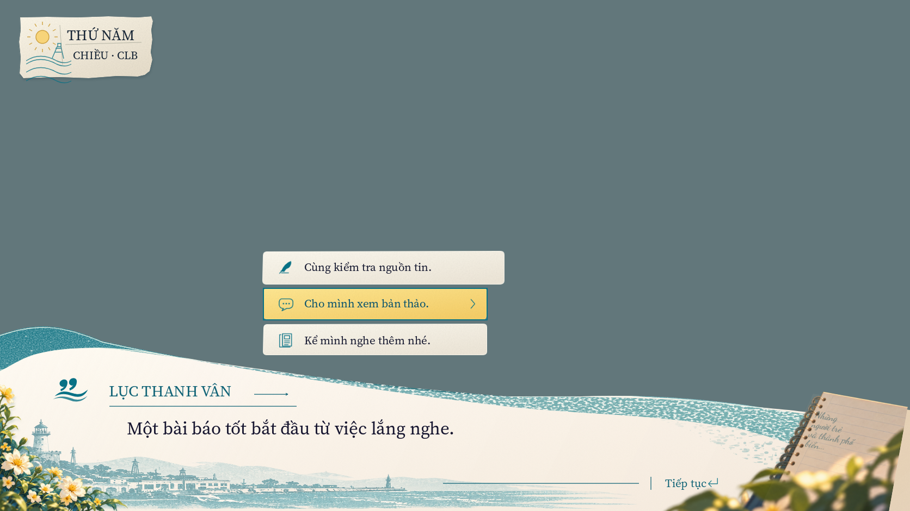
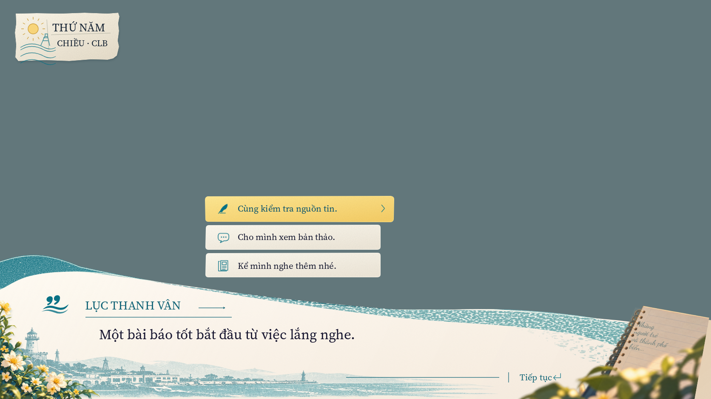

# Coastal UI correction — 2026-10-11

Click choice trong preview từng dựng lại view rồi đưa focus về choice đầu, làm
highlight rời lựa chọn vừa bấm. View nay tìm selected choice bằng ID và giữ focus
đúng ở cả click/keyboard/reconfigure. Choice selected có ink xanh và weight 600;
choice thường dùng style authored riêng. Text dài được fit lại khi style thay đổi,
giữ hit target và full copy trong tooltip/accessibility.

Composition tạo và giữ một FontVariation bất biến cho mỗi family/weight trong
layout. View chọn resource khi đổi focus, tránh tạo variation theo từng label
hoặc đổi weight của resource đang dùng. Đây là ownership/tái sử dụng resource UI;
không có global cache, singleton hay thay đổi domain/save/balance/text catalog.
API: [FontVariation](https://docs.godotengine.org/en/stable/classes/class_fontvariation.html).

Art v4 làm sáng giấy, giảm độ đậm harbor print, thêm wash mực trong mép phải,
stitch thanh nhiệm vụ và cạnh date HUD nhỏ hơn. Date dialogue v4 làm diagnostic
xấu đi; v5 giữ lại envelope/master gốc và thêm ruling lines. Master/font/prompt,
reference, baselines, PNG/manifest/review cũ đều giữ nguyên byte.

## Evidence hiện hành

- 661 headless contracts, 0 failures; architecture/reference/content integrity pass.
- 64 native checks ở năm window sizes: pointer/Tab/Enter/M, focus sau click,
  input lock/travel, selected/idle glyphs và icons trên cả bốn nền.
- 24 [captures-v7](captures-v7/) là bộ hiện hành. Tool capture kiểm trực tiếp pixel
  glyph/icon của mọi choice trong các frame dialogue 1672×941 và fail nếu thiếu.
  Có selected-draft/selection-return, text dài, money lớn/prompt mép và playable.
- [Video v7](ui-correction-v7.mp4) dùng fixed 30 FPS, không là measurement hiệu năng.
- Profile real clock: 14 runs/4200 measured frames, cap 120/VSync off,
  [summary](profile-summary.json) và [raw samples](native-profile.json).
- Windows debug/release chạy self-check từ thư mục tạm chỉ có distribution files;
  clean Git index snapshot import/contract/boot cũng được kiểm. Xem [evidence](evidence.json)
  và [inventory](inventory.json) cho logs, hashes, build bytes và snapshot scope.

## Đối chiếu theo vùng

Nguồn/mask không đổi. [Dialogue diagnostic](ui-comparison-v7.json) có 444170 pixels:
MAE giảm **23.422 → 22.303/255**; không có ngưỡng nghiệm thu hoặc zero-diff claim.
[Regions](dialogue-regions-v7.json) dùng các subdivisions authored trong
`docs/ui-specs/coastal-review-regions.json`; vùng có thể chồng lấn và không cộng
thành tổng. Tất cả đều intersect với mask bảo thủ gốc.

| Vùng | Trước | Sau | Nhận xét |
| --- | ---: | ---: | --- |
| Date/ornament/type | 29.829 | 29.614 | Envelope v4 bị loại vì regression |
| Choices/material/copy/icons | 19.333 | 19.120 | Thay style selected, vẫn còn shape/type gaps |
| Speaker/copy/rule/mark | 18.818 | 22.876 | Regression cần follow-up |
| Dialogue line | 20.226 | 17.438 | Giấy sáng hơn |
| Paper interior | 8.562 | 5.882 | Giảm grain tối |
| Harbor bottom | 30.930 | 26.825 | Print nhạt hơn |
| Attached flowers | 36.848 | 37.330 | Giữ asset gốc; compositing còn lệch |
| Attached notebook | 33.378 | 33.643 | Giữ asset gốc; compositing còn lệch |

[HUD date-only diagnostic](hud-regions-v7.json) trên interior giấy 22480 pixels
giữ MAE 31.487. Frame stitch/cạnh mực không nằm trong rectangle này; ink/footer
fringes còn alpha không rõ và không được score cả rectangle chứa world.

**C11.05/G2 vẫn mở.** Cần correction speaker/mark, attached decoration compositing
và wave/material/type; mask riêng cho HUD ink/footer và mixed reference alpha
chưa đủ để đóng gate. World/portrait matching không là điều kiện chặn UI gate.

## Diễn giải và lịch sử thử nghiệm

Nhận định trong progress update rằng vài PNG hôm nay mất chữ là đọc nhầm hiển thị
ảnh rút gọn của công cụ. Kiểm bytes/pixels cho thấy các PNG có đủ chữ/icon; ví dụ
neutral v3/v4/v5/v6 có cùng SHA256 và 612 dark glyph pixels + 91 teal icon pixels
trong hai ROI của choice thứ hai. Không có claim đã sửa renderer bug từ việc đó.
Font resource ownership vẫn được giữ vì style/focus là feature cụ thể cần nó.

Lần native đầu có hai fail vì probe cũ tìm navy trong label selected đã chuyển
sang teal; predicate được cập nhật theo style authored, không hạ ngưỡng pixel.
Probe nay kiểm cả selected/idle/icons từ PNG gốc thay vì nhận xét qua ảnh hiển thị.
Thử nghiệm chờ một frame khi thay preview đã bỏ; prototype làm capture v5 dừng vì
caller dùng view trước khi mount. API show_case cuối vẫn synchronous như trước.

Các captures v1–v5 và diagnostic trước v6 giữ lịch sử, không là bộ nghiệm thu cuối.
Các file tên `*-final.json` cũ trong review này được tạo từ captures-v3;
current pointer luôn là v6 và inventory/evidence hiện hành. Không overwrite hoặc xóa.

Source `hai-vong` không đổi; browser suite không chạy vì JS/HTML không thay đổi.
PNG 4:3/ultrawide chứa viewport content, không chứa bars ngoài window. Pointer
checks dùng final window transform. Controller input được inject, chưa thử tay cầm
vật lý. Profile là mẫu ngắn trên một laptop/editor đang mở, không là soak hoặc máy yếu.
