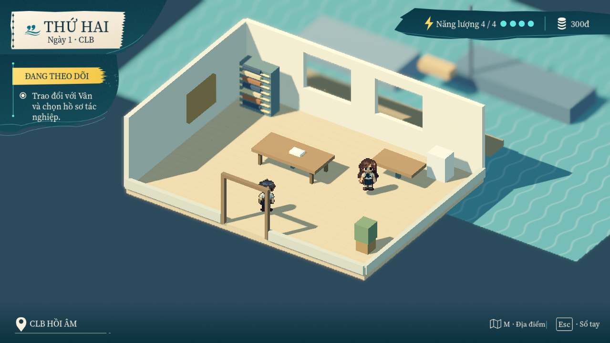
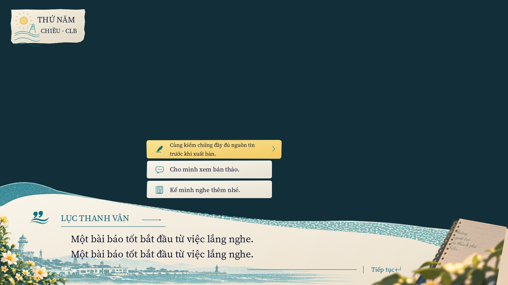

# UI upgrade — 2026-10-10

HUD trong playable đã chuyển từ các panel chữ nhật sang bố cục coastal dựa trên
`03-hud-map.png`: khung mực, giấy ngày tháng, thanh nhiệm vụ, năng lượng/tiền và
footer địa điểm. M hoặc click Địa điểm mở workspace travel; Esc/Menu vẫn mở sổ tay.
State thật cấp tiền, năng lượng và nhiệm vụ; fixture review nằm riêng trong content.

Dialogue giữ flowers/notebook/harbor gốc, thêm wash giấy, weight chữ và transform
affine cho ghi chú. Choice dài xuống tối đa hai dòng trong hit target cũ, chữ tiền
lớn thu nhỏ trong vùng cố định và prompt tương tác được giữ trong mép viewport.
Chữ hiển thị đều từ catalog; domain, save schema, gameplay/formula và baseline không đổi.

## Kiểm tra và hình hiện hành

- 655 headless checks, 0 failures; architecture/reference/content integrity pass.
- 53 native checks, 0 failures ở 1672×941, 1280×720, 1920×1080, 1024×768 và
  2560×1080: pointer qua letterbox, Tab/Enter, M, input lock và playable travel.
- Kiểm render GPU xác nhận glyph và icon vẫn hiện sau configure lại dialogue.
  Trước sửa, headless vẫn thấy Label.text nhưng ảnh native mất chữ/icon.
- 22 [captures-v3](captures-v3/) là evidence cuối: bốn background, năm window sizes,
  text dài, tiền lớn/prompt mép và bốn trạng thái playable. Captures v1 giữ lỗi
  render tìm thấy; v2 xác nhận font fix, v3 dùng HUD frame đã chỉnh cạnh mực/giấy.
- Windows debug/release được chạy từ thư mục tạm chỉ có EXE/PCK/dependencies/licenses;
  packaged self-check kiểm gameplay, management, save/load, sandbox, glyph và room travel.
- [Video native](ui-upgrade.mp4) dùng fixed cadence 30 FPS để review UI; không là
  measurement hiệu năng. Profile real clock có 14 runs/4200 measured frames, VSync
  off/cap 120, trên RTX 3050 Ti/Forward+ D3D12; xem [summary](profile-summary-final.json).

Đối chiếu HUD trước ở [review 06–12](../chapters-06-12/captures-v8/room-high.png)
và [preview 01–05](../chapters-01-05/captures-v3/hud-neutral.png).
Fixture mới dùng ngày/phase/energy/money/location từ concept; copy fixture cũ khác.

## Art và khả năng tái tạo

Không overwrite asset gốc. V2 thêm bốn SVG text-free và PNG tương ứng trong
`assets/ui/coastal/authored_v2/`/`runtime_v2/`, recipe `tools/coastal_v2_art.py`.
V3 sửa duy nhất HUD frame từ source v2, giữ SVG/PNG v2 và v3; recipe
`tools/coastal_v3_art.py` dùng seed cố định ở tooling cho grain/mực.
Source hình học do project authoring từ bố cục tham chiếu; insignia nhúng từ
master gốc, wash lấy thông số trong source UI spec. Không có bitmap concept có chữ
được dùng làm UI. Font/license/masters, prompts, reference bytes và baselines gốc
được giữ nguyên. Source và texture hashes nằm trong các manifest versioned.

`content/manifest.json` chọn `art_manifest_v3.json` gồm 20 textures: 16 gốc và
bốn bổ sung, với HUD frame v3. Runtime chỉ load PNG và native text; source SVG/tools
không ship. `tools/bake_ui_art.py --version 2|3` dùng Chromium để raster SVG filters
và từ chối ghi đè thư mục version đã tồn tại; thay đổi tiếp phải có version mới.

Font weight dùng FontVariation mới trỏ về base font, tránh duplicate cache của
variation hiện hành. Notebook dùng transform basis/rotation từ layout content.
Các API liên quan: [FontVariation](https://docs.godotengine.org/en/stable/classes/class_fontvariation.html),
[Node2D transform](https://docs.godotengine.org/en/stable/classes/class_node2d.html).

## Giới hạn nghiệm thu

Đây là UI correction pass có native evidence; **C11.05/G2 vẫn mở**.
[Dialogue masked comparison](ui-comparison.json) có 444170 pixels, RGB MAE
23.422/255; trước là 23.409/255. Chênh lệch nhỏ này không chứng minh pixel parity
hay cải thiện toàn bộ dialogue. Mask giữ nguyên source interior bảo thủ;
fringe/occluded alpha chưa giải quyết, không đặt ngưỡng pass tùy ý.
HUD mới là bản authoring theo concept, chưa có masked acceptance riêng cho HUD.
World/portrait matching tiếp tục theo scope riêng và không được dùng để chặn UI gate.

Captures ở 4:3/ultrawide chứa vùng nội dung viewport sau aspect KEEP; bar ngoài
window không nằm trong PNG. Native pointer checks đi qua final window transform.
Controller input được inject qua Godot; chưa thử gamepad vật lý. Profile là mẫu
ngắn trên một laptop, editor/user play đang mở; không là stress test hoặc máy yếu.
Profile v1 có thể chồng workload export nên chỉ giữ lịch sử; final chạy riêng sau export.
Không sửa source `hai-vong`; browser suite nguồn không chạy vì không đổi JS/HTML.

[Evidence máy đọc](evidence.json) và [inventory byte/hash](inventory.json) ghi
logs, build outputs, source/assets và clean staged checkout dùng cho verification.
